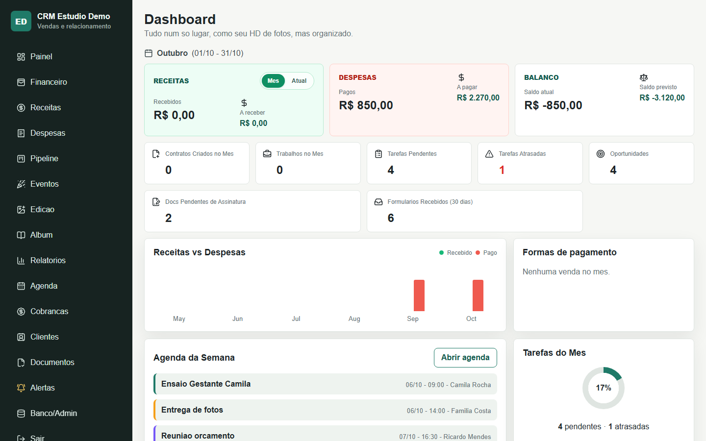
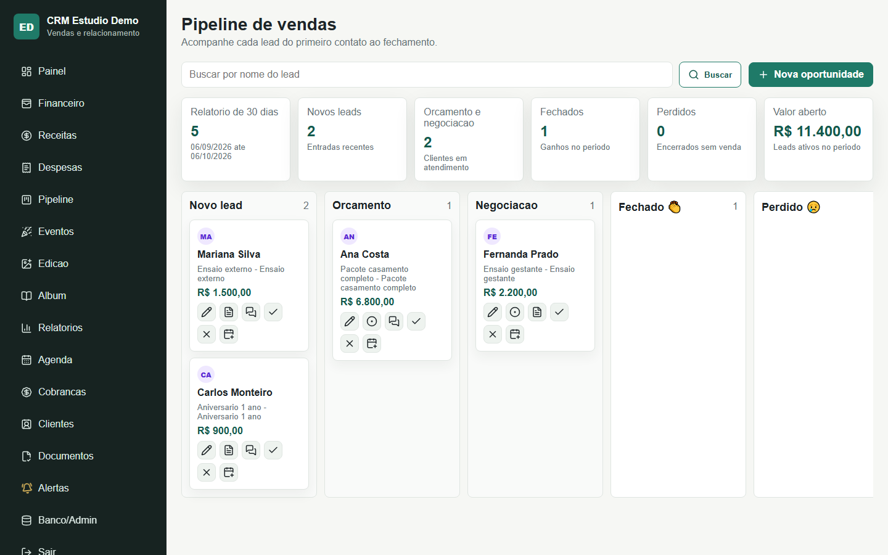
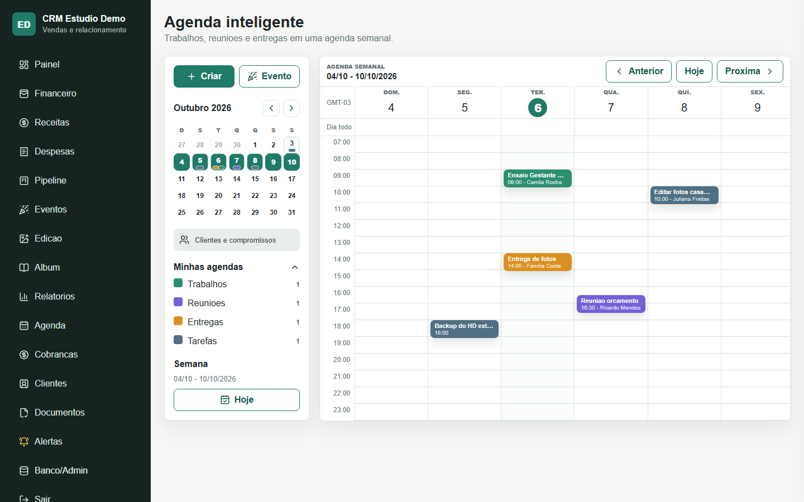
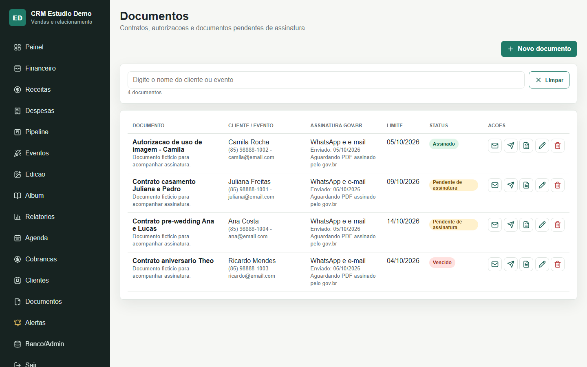
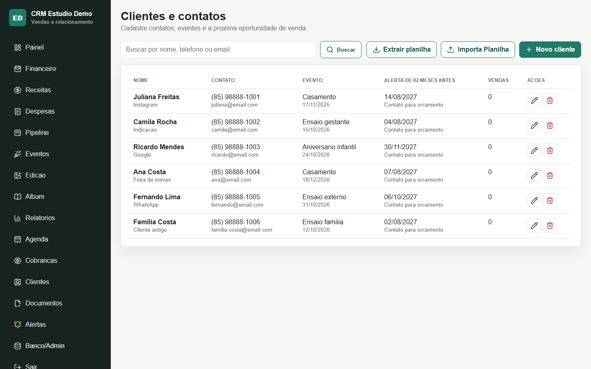
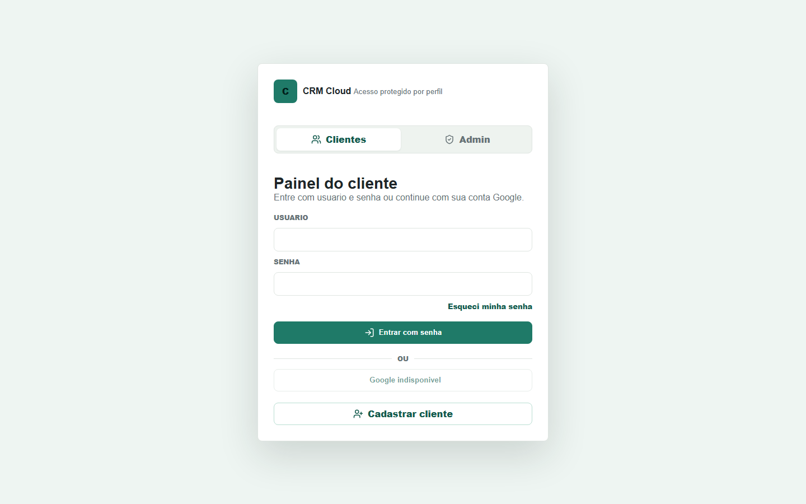
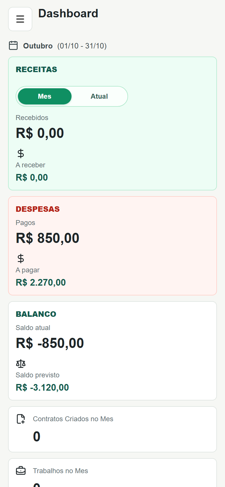

# CRM Fotógrafos

CRM web para estúdios e fotógrafos organizarem clientes, vendas, contratos, agenda e financeiro em um só lugar. O sistema é multiempresa: cada estúdio enxerga apenas os próprios dados, e um painel de administração central acompanha as empresas, contratos e cobranças da plataforma.

**Sistema no ar:** https://crm-fotografos.vercel.app

> O acesso exige login. As telas abaixo foram geradas com os dados fictícios do comando `seed_demo`.

## Telas

| Dashboard | Pipeline de vendas |
| --- | --- |
|  |  |

| Agenda | Documentos e contratos |
| --- | --- |
|  |  |

| Clientes | Login | Mobile |
| --- | --- | --- |
|  |  |  |

## Funcionalidades

- **Dashboard** com receitas, despesas, saldo, contratos do mês, tarefas e agenda da semana.
- **Pipeline de vendas** do primeiro contato ao fechamento, com motivos de perda e reuniões.
- **Financeiro** com vendas, parcelas, adiantamentos, recebimentos parciais e valor líquido no cartão.
- **Receitas e despesas** com relatórios mensais em PDF.
- **Eventos e produção**: painéis de edição e de álbum para acompanhar a entrega de cada trabalho.
- **Agenda** de ensaios, reuniões, entregas e pagamentos a receber.
- **Contratos e documentos** gerados em PDF, com envio por WhatsApp ou e-mail e controle de assinatura.
- **Alertas** de parcelas vencidas, cobranças ativas e oportunidades de recompra.
- **Clientes** com importação e exportação por planilha.
- **Multiempresa** com perfis de acesso (admin master, admin da empresa e usuário) e painel central da plataforma.
- **Login** por usuário e senha ou conta Google, com recuperação de senha por e-mail.

## Tecnologias

| Camada | Tecnologia |
| --- | --- |
| Backend | Python 3.12, Django 5 |
| Banco de dados | PostgreSQL (Supabase) em produção, SQLite no ambiente local |
| Segurança de dados | Row Level Security no Supabase, autenticação por cookie JWT |
| Arquivos | Supabase Storage |
| Frontend | Django Templates, HTML, CSS e JavaScript |
| Integrações | WhatsApp Cloud API, SMTP, Google OAuth |
| Deploy | Vercel (região `gru1`), WhiteNoise para arquivos estáticos |

## Como rodar localmente

Pré-requisitos: Python 3.12 ou superior e Git.

```bash
git clone https://github.com/falcao27/CRM_Fotografos.git
cd CRM_Fotografos

python -m venv .venv
# Windows
.venv\Scripts\activate
# Linux/macOS
source .venv/bin/activate

pip install -r requirements.txt
```

Crie o arquivo de configuração a partir do exemplo:

```bash
# Windows
copy .env.example .env
# Linux/macOS
cp .env.example .env
```

Sem `DATABASE_URL` preenchida, o projeto usa um banco SQLite local, então nenhuma conta externa é necessária para testar.

```bash
python manage.py migrate
python manage.py createsuperuser
python manage.py seed_demo      # opcional: cria clientes, vendas e tarefas fictícias
python manage.py runserver
```

Acesse http://127.0.0.1:8000 e entre com o usuário criado.

### Testes

```bash
python manage.py test
```

## Variáveis de ambiente

Todas estão descritas em [`.env.example`](.env.example). O arquivo `.env` real nunca é versionado.

| Variável | Para que serve |
| --- | --- |
| `SECRET_KEY`, `DEBUG`, `ALLOWED_HOSTS`, `CSRF_TRUSTED_ORIGINS` | Configuração básica do Django |
| `DATABASE_URL` | Conexão com o PostgreSQL do Supabase (vazio usa SQLite local) |
| `SUPABASE_URL`, `SUPABASE_SECRET_KEY`, `SUPABASE_STORAGE_BUCKET` | Armazenamento de contratos e anexos |
| `GOOGLE_OAUTH_CLIENT_ID`, `GOOGLE_OAUTH_CLIENT_SECRET` | Login com Google |
| `CRM_MASTER_ADMIN_EMAIL` | E-mail do administrador da plataforma |
| `WHATSAPP_*` | Envio de documentos pela WhatsApp Cloud API |
| `EMAIL_*`, `DEFAULT_FROM_EMAIL` | Envio de e-mails por SMTP |

## Estrutura

```text
crm/                 App principal: models, views, services, PDF, middleware e testes
crm/management/      Comandos seed_demo e setup_supabase_storage
crm/storage/         Backend de arquivos para o Supabase Storage
crm_fotografos/      Configurações do projeto Django
templates/crm/       Telas do sistema
static/crm/          CSS e identidade visual
supabase/            Scripts SQL de auditoria e correção de RLS
docs/                Prints e guia de instalação local
```

## Deploy

O deploy de produção roda na Vercel. O `build.sh` coleta os arquivos estáticos e aplica as migrations; as variáveis de ambiente ficam cadastradas no painel da Vercel e o banco usa o Transaction Pooler do Supabase.

O projeto também pode ser instalado como programa local em um computador Windows, com atalho na área de trabalho e backup automático. O passo a passo está em [docs/INSTALACAO_WINDOWS.md](docs/INSTALACAO_WINDOWS.md).

## Autor

Desenvolvido por [Jefferson Falcão](https://github.com/falcao27).
